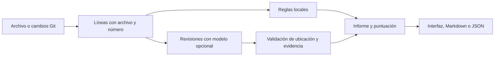

# PR Review Assistant

**PR Review Assistant** es un prototipo local que ayuda a revisar código antes de integrarlo en un proyecto. Combina reglas para detectar patrones de riesgo con revisiones opcionales mediante modelos de lenguaje. Presenta los resultados en una interfaz web local o en informes Markdown y JSON desde la terminal.

Su objetivo es ofrecer una segunda mirada y facilitar la conversación entre desarrolladores: cada observación incluye una ubicación, una evidencia y una recomendación. El resultado debe revisarlo una persona; la herramienta no garantiza que el código sea correcto ni seguro.

## ¿Qué problema resuelve?

Una revisión de código puede pasar por alto un detalle, especialmente cuando hay muchos cambios o poco tiempo. Este proyecto reúne en un informe señales que ayudan a orientar la revisión, por ejemplo, una llamada a `eval()` o un posible problema de seguridad detectado por un modelo.

Puede ser útil para preparar un pull request, explorar un archivo, demostrar un flujo de revisión asistida por IA o comparar observaciones de reglas locales y modelos. Según el proveedor elegido, el código revisado puede enviarse a un servicio externo.

## Dos formas de revisar

1. **Archivo completo:** desde la interfaz se selecciona un archivo de texto UTF-8, no vacío y de hasta 256 KB. Se analizan sus líneas completas y se conserva su numeración en los hallazgos.
2. **Cambios de Git:** se indica un repositorio local y una referencia base, como `main` u `origin/main`. La aplicación obtiene las líneas añadidas en `git diff BASE...HEAD`. Los cambios deben estar incluidos en commits alcanzables desde `HEAD`; no analiza cambios sin confirmar.

El programa no ejecuta el código revisado ni modifica el repositorio analizado. La integración actual lee Git local: no obtiene un pull request desde GitHub ni publica comentarios automáticamente.

## Cómo funciona



1. **Preparación:** convierte el archivo seleccionado o las líneas añadidas del diff en entradas con ruta y número de línea.
2. **Reglas locales:** busca patrones concretos en archivos Python, como `eval`, `exec`, deserialización con `pickle`, determinados usos de `shell=True` y posibles secretos escritos directamente. Son búsquedas heurísticas, no un análisis exhaustivo.
3. **Revisión con IA, opcional:** el proveedor seleccionado recibe las líneas y realiza hasta tres solicitudes especializadas: corrección, seguridad y pruebas o mantenibilidad. Son llamadas independientes a un modelo con instrucciones distintas.
4. **Validación:** se descartan observaciones cuya ruta, línea o evidencia no coincidan con las líneas examinadas, así como algunos campos inválidos. Esta comprobación no demuestra que la explicación del modelo sea correcta.
5. **Informe:** se presentan los hallazgos y avisos. Si una solicitud falla, se detienen las llamadas restantes y se conservan los resultados obtenidos hasta entonces, incluidas las reglas locales.

La interfaz muestra una gráfica por severidad y una puntuación orientativa. La puntuación comienza en 100 y resta puntos por cada hallazgo: 30 por crítico, 15 por alto, 7 por medio y 3 por bajo; los informativos no restan. Actualmente los hallazgos duplicados pueden penalizar varias veces el mismo problema, por lo que no debe interpretarse como una medida objetiva de calidad o seguridad.

## Proveedores de modelos

| Opción | Configuración | Funcionamiento |
| --- | --- | --- |
| Solo reglas locales | Ninguna clave | Ejecuta las reglas de Python sin solicitudes a un modelo. |
| OpenRouter | `OPENROUTER_API_KEY` | Seleccionado por defecto en la interfaz. Usa `nvidia/nemotron-3-ultra-550b-a55b:free` salvo que se configure otro modelo mediante `OPENROUTER_MODEL`. Solo acepta identificadores terminados en `:free`. |
| Gemini | `GEMINI_API_KEY` | Usa `gemini-3.5-flash` por defecto; admite `GEMINI_MODEL` o `--model`. |
| Groq | `GROQ_API_KEY` | Usa `openai/gpt-oss-120b` por defecto; admite `GROQ_MODEL` o `--model`. |
| Ollama | Servidor y modelo locales | Usa `qwen2.5-coder:7b` por defecto; requiere Ollama instalado y el modelo descargado. |

La disponibilidad, los límites de uso y los modelos pueden cambiar. Un modelo gratuito puede no estar disponible en todo momento. Cada revisión con IA puede consumir hasta tres solicitudes, además de los reintentos que realicen algunos clientes.

## Instalación

Se necesitan **Python 3.11 o superior** y **Git** para revisar cambios de un repositorio. El proyecto utiliza la biblioteca estándar de Python y no requiere una clave para el modo de reglas locales.

Clona el repositorio y, desde su carpeta, ejecuta en PowerShell:

```powershell
python -m venv .venv
.\.venv\Scripts\Activate.ps1
python -m pip install -e .
```

Para utilizar una API, copia la plantilla y configura únicamente las claves necesarias en el archivo local `.env`:

```powershell
Copy-Item .env.example .env
```

Edita `.env` con tu editor y añade, por ejemplo, el valor de `OPENROUTER_API_KEY`. **No subas ese archivo ni compartas sus claves.** El repositorio incluye `.env` en `.gitignore`. Si una variable ya está definida en el entorno de la sesión, tiene prioridad sobre la del archivo.

## Uso de la interfaz

Desde la carpeta del proyecto, con el entorno activado:

```powershell
python -m pr_review.web
```

Se abre `http://127.0.0.1:8765/`. Selecciona **Un archivo** o **Cambios de un repositorio Git**, elige el motor y pulsa **Analizar cambios**. El informe muestra la puntuación, los hallazgos, una gráfica y cualquier aviso de revisión parcial. Para cerrar el servidor, pulsa `Ctrl+C` en la terminal.

El servidor escucha en la dirección local del equipo. Con OpenRouter, Gemini o Groq, el archivo completo o las líneas añadidas se envían al proveedor elegido. Ollama utiliza su servidor local. Para probar servicios externos, emplea código público o sintético y revisa las condiciones de tratamiento de datos del proveedor.

## Uso desde la terminal

La CLI revisa los cambios confirmados de un repositorio respecto de una base:

```powershell
# Desde el repositorio que deseas revisar
pr-review --base origin/main
pr-review --base origin/main --provider openrouter --format markdown --output review.md
pr-review --base origin/main --provider groq --format json --output review.json
```

Se puede indicar otra ruta con `--repo`, seleccionar `gemini` u `ollama` con `--provider` y elegir un modelo con `--model`. Sin `--provider`, se ejecutan solo las reglas locales. `--llm` es un alias para seleccionar Gemini.

Para ver una demostración sin API desde la carpeta del proyecto:

```powershell
python examples\demo.py
```

La demo crea un repositorio temporal con un cambio sintético que contiene `eval()` y muestra el informe; no ejecuta el código del ejemplo. Para añadir una revisión con IA se puede ejecutar `python examples\demo.py --provider openrouter` con la clave configurada.

## Estructura

```text
src/pr_review/  CLI, lectura de Git, reglas, proveedores, informes y servidor local
web/            Interfaz HTML, estilos y lógica del navegador
examples/       Demo con repositorio sintético
.env.example    Plantilla de configuración sin claves
```

## Límites y estado del proyecto

Esta es una **versión de demostración**, no una herramienta de seguridad certificada. Las reglas locales solo cubren unos pocos patrones de Python y pueden producir falsos positivos o no detectar un problema. La revisión con IA puede equivocarse, repetir hallazgos o carecer del contexto necesario: en el modo Git recibe las líneas añadidas, no el repositorio completo. Las solicitudes pueden fallar por cuota, capacidad o conexión; los avisos indican si el informe está incompleto.

No se generan ni aplican parches automáticamente y no se ejecutan las pruebas del proyecto revisado. Tampoco se ha completado una evaluación estadística de precisión y cobertura. Antes de integrar cambios, una persona debe contrastar los hallazgos y ejecutar las pruebas apropiadas del proyecto.

## Licencia

MIT. Consulta [LICENSE](LICENSE).
