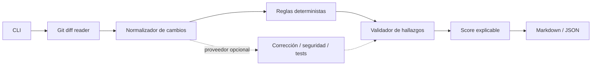

# PR Review Assistant

Asistente local de revisión de cambios para pull requests. Combina reglas deterministas con revisores LLM opcionales y genera un informe reproducible con hallazgos enlazados a líneas del diff.

> Estado: prototipo local. El modo determinista funciona sin credenciales ni dependencias de terceros. La publicación en GitHub y la ejecución de tests del repositorio quedan fuera del alcance actual.

## Qué demuestra

- Python moderno, CLI y separación por capas.
- Revisión aumentada por IA con resultados estructurados y evidencia verificable.
- Seguridad al tratar el código y la documentación analizados como entrada no confiable.
- Diseño medible: corpus de cambios sembrados, precisión, cobertura, falsos positivos, coste y latencia.

## Inicio rápido

### Interfaz local

Desde la carpeta de este proyecto ejecuta `python -m pr_review.web` después de instalarlo con `python -m pip install -e .`. Se abrirá `http://127.0.0.1:8765/`: selecciona un archivo de texto UTF-8 de hasta 256 KB para revisarlo entero, o elige la revisión de cambios de un repositorio Git e introduce la ruta y la referencia base. La gráfica muestra el número de hallazgos por severidad; los avisos identifican una revisión parcial. Pulsa Ctrl+C en la terminal para cerrar el servidor. Los proveedores externos reciben el archivo completo en el primer modo y las líneas añadidas en el segundo.

El archivo `.env` en la raíz permite configurar `GEMINI_API_KEY`, `GROQ_API_KEY` y `OPENROUTER_API_KEY`. Las variables ya establecidas en la sesión tienen prioridad. La interfaz selecciona OpenRouter por defecto con `nvidia/nemotron-3-ultra-550b-a55b:free`; `OPENROUTER_MODEL` o `--model` permite usar otro identificador terminado en `:free`. `.env` está excluido de Git; usa `.env.example` como plantilla y no lo publiques. Las claves permanecen en el servidor local. Los proveedores externos reciben las líneas añadidas del diff.

Requiere Python 3.11+ y Git. Desde la raíz de un repositorio con cambios:

```bash
python -m pr_review --base origin/main --format markdown
python -m pr_review --base origin/main --format json --output review.json
```

Para añadir revisores LLM, selecciona `--provider openrouter`, `--provider gemini`, `--provider groq` o `--provider ollama`. Gemini también acepta `--llm` como alias. Cada proveedor recibe las líneas añadidas del diff; consulta [proveedores y cuotas](docs/providers.md) antes de usar una API externa.

El comando examina únicamente las líneas añadidas en `git diff BASE...HEAD`; no ejecuta el código examinado. Si no hay un `HEAD` o una base válida, informa del error sin modificar el repositorio.

## Alcance actual

- Carga del diff de Git y extracción de líneas añadidas.
- Reglas locales iniciales para patrones peligrosos de Python.
- Revisores LLM optativos con salida estructurada y validación local de rutas, líneas y evidencia.
- Proveedores Groq y Ollama local con la misma validación de hallazgos.
- Reintento limitado ante HTTP 503 y degradación al informe local si el proveedor sigue sin responder.
- Hallazgos con archivo, línea, categoría, severidad, evidencia y recomendación.
- Salida Markdown y JSON; score orientativo con desglose.
- Sin escritura en GitHub, sin aplicación de parches y sin ejecución de comandos del proyecto.
- La revisión LLM realiza tres solicitudes (una por especialidad); las cuotas gratuitas dependen del modelo y proyecto.

## Arquitectura



Consulta [la demo sin API](docs/demo.md), [proveedores y cuotas](docs/providers.md), [opción local para este equipo](docs/local-model.md), [arquitectura](docs/architecture.md), [decisiones](docs/adr/), [modelo de amenazas](docs/threat-model.md) y [plan de evaluación](docs/evaluation-plan.md).

## Desarrollo

Los pasos de instalación y ejecución están en [desarrollo](docs/development.md). El modo determinista no necesita API; los proveedores LLM son optativos.

## Limitaciones

Las reglas estáticas iniciales son señales, no un análisis exhaustivo de seguridad. El score no certifica calidad ni ausencia de vulnerabilidades. Los hallazgos deben revisarse por una persona. Los comentarios en PR y los parches sugeridos se incorporarán en fases separadas y con aprobación humana.

## Licencia

MIT. Consulta [LICENSE](LICENSE).
